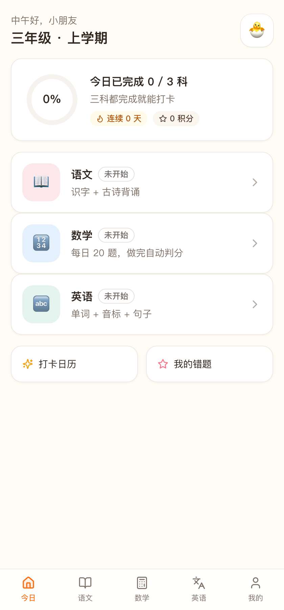
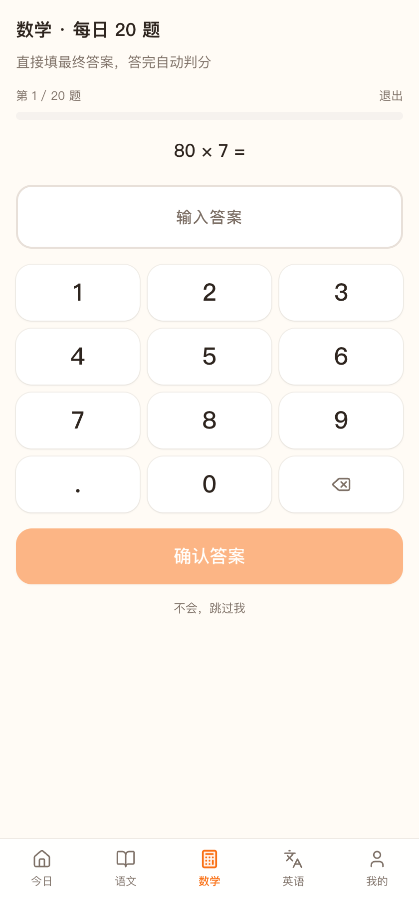
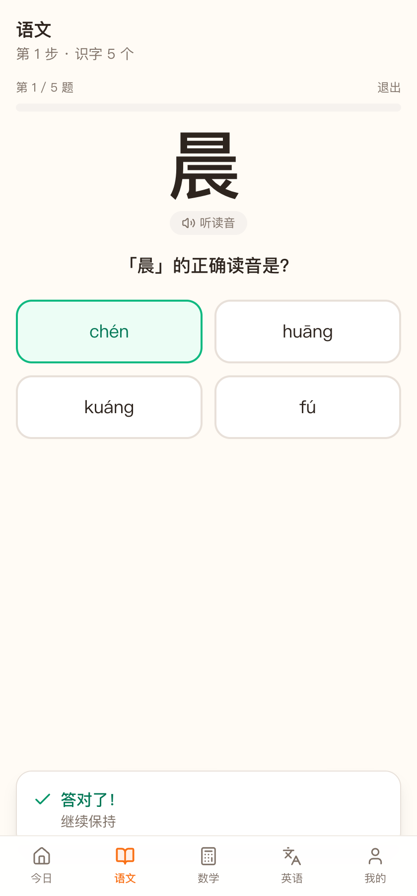
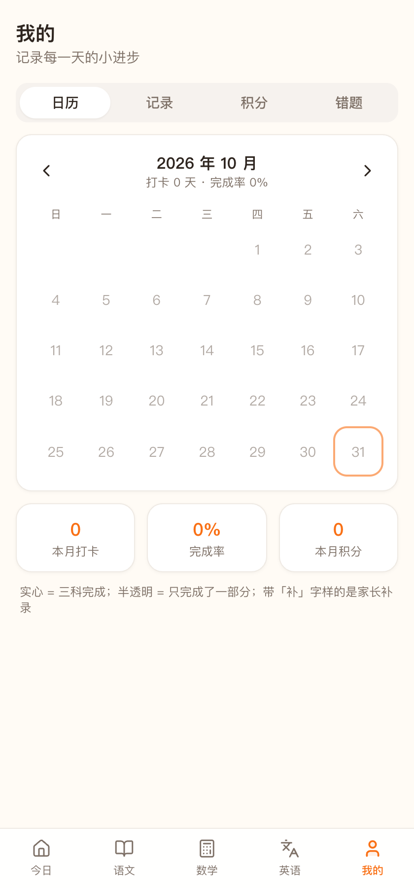
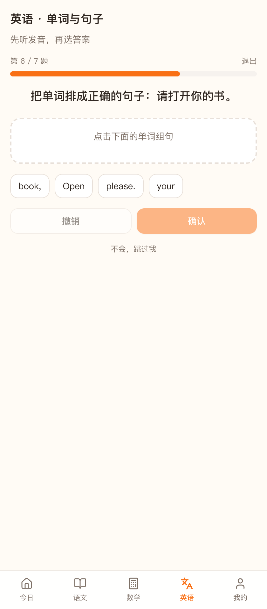
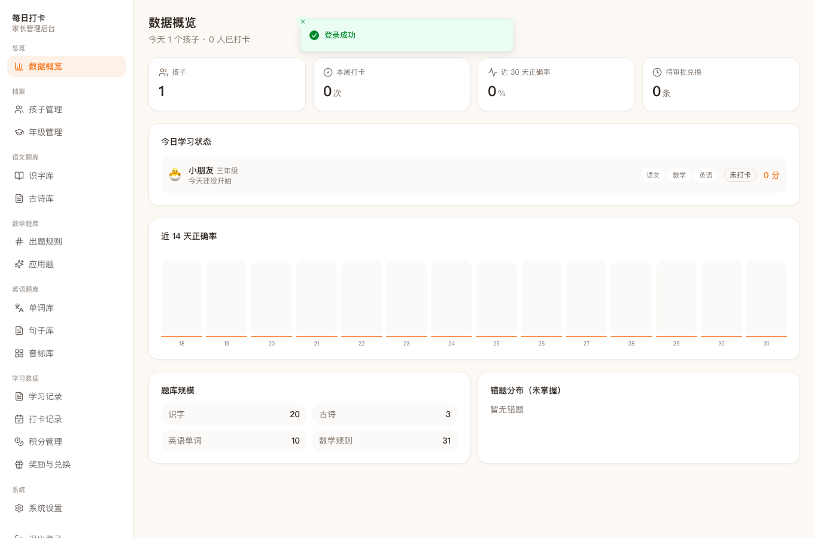

# 每日打卡 · 学习小助手

给小学生用的每日学习打卡 Web 应用。孩子打开就能学（无需登录），家长在后台管题库、看数据。

- 语文：每日识字（选拼音/选组词）+ 古诗（听读 → 背一遍录下来，家长后台可回听）
- 数学：每日 20 题，严格按孩子的年级 + 学期知识点出题，直接填答案，自动判分（不能跳过）
- 英语：每日单词 + 音标 + 句子排序
- 打卡：三科完成才算打卡，连续天数、积分、奖励兑换
- 断点续做：做到一半退出也没关系，回来从第 N+1 题接着做
- 后台：孩子、三科题库（支持大模型辅助录入）、学习记录、背诵录音、打卡补录/作废、积分、奖励审批、数据备份

技术栈：React 18 + TypeScript + Tailwind + shadcn 同源组件 / Flask 3 + SQLAlchemy + SQLite。

## 界面预览

| 客户端首页 | 数学练习 | 语文答题 |
|---|---|---|
|  |  |  |

| 打卡日历 | 英语句子 | 后台概览 |
|---|---|---|
|  |  |  |

## 快速开始

```bash
# 1. 后端
cd api
python3 -m venv .venv
.venv/bin/pip install -r requirements.txt
cp .env.example .env      # 修改密码
.venv/bin/python run.py   # http://localhost:5001

# 2. 前端（开发模式，另开一个终端）
cd web
npm install
npm run dev               # http://localhost:5173
```

生产用法（单端口，局域网可用）：

```bash
cd web && npm install && npm run build
cd ../api && .venv/bin/python run.py
# 电脑访问 http://localhost:5001，iPad/手机访问 http://<电脑局域网IP>:5001
```

首次启动自动建库并写入：年级（小学 1-6 + 初一至初三，内置只读）、示例孩子、37 条按上下学期分布的数学出题规则、20 个识字示例、3 首古诗、10 个单词、48 个国际音标、4 个奖励。

启动后到后台「系统设置 → 内置题库」点一下导入，识字库和古诗库立刻就满了，不用手工录入。

- 客户端：`http://localhost:5001/`（无需登录）
- 后台：`http://localhost:5001/admin`（默认 `admin` / `admin123`，请登录后修改）

## 目录

```
docs/   需求说明、技术设计、开发计划
api/    Flask 后端（models / api / services / seed）
web/    React 前端（客户端 + 管理后台两个入口）
db.sqlite
```

## 功能模块

| 模块 | 内容 |
|---|---|
| 今日任务 | 三科进度、打卡状态、连续天数、积分 |
| 语文 | 识字（新字 + 遗忘曲线复习）、古诗三步骤 |
| 数学 | 20 题、数字键盘、即时对错、错题本 |
| 英语 | 单词选择题、音标专项、句子排序 |
| 我的 | 打卡日历、学习记录与正确率、积分兑换、错题本 |
| 后台 | 概览看板、三科题库、记录、打卡、积分、奖励、设置与备份；孩子在「系统 → 孩子管理」 |

每天的任务会先插 2 道**错题重练**（可调），答对一次记一次、累计两次算掌握，之后不再出现。

## 数据与备份

- 所有数据都在根目录 `db.sqlite`，复制即迁移。
- 每天首次启动自动备份到 `backups/db-YYYY-MM-DD.sqlite`（保留 7 份）。
- 后台「系统设置 → 下载数据库」可随时手动备份。

## 内置题库（一键导入）

项目自带两份数据包，不联网、不用一条条录：

| 数据包 | 内容 |
|---|---|
| 识字库 | 2176 个小学常用汉字，含拼音、部首、笔画、结构、组词 |
| 古诗库 | 统编（部编）版小学语文课内古诗词 112 首 |

后台 → 系统设置 → 内置题库，点「导入」即可，2158 字 + 104 首约 0.05 秒写完。
已存在的条目按汉字 / 古诗标题自动跳过，不会覆盖你改过的内容，重复点也没有副作用。

导入后的默认行为：

- 语文、英语题库**不关联年级学期**，早中晚抽到的字、诗、单词从全库随机来
- 只有数学按孩子的年级 + 学期出题

数据来源与构建方式（想换数据源或重新生成时用）：

```bash
cd api
.venv/bin/python scripts/build_chars.py   # 联网下载 Unihan / IDS / 生字表 / 词语表后重建
.venv/bin/python scripts/build_poems.py   # 纯本地，改脚本里的 POEMS 列表即可
```

- 汉字：小学常用汉字生字表（年级） + Unicode 官方 Unihan（拼音 `kMandarin`、笔画 `kTotalStrokes`、部首 `kRSUnicode`） + CJKVI IDS（结构） + 统编教材词语表与 12 册课文语料（挑组词，CC-CEDICT 兜底）
- 古诗：人民教育出版社统编版小学语文教材 1-6 年级课内篇目
- 生成的 JSON 在 `api/app/seed/data/`，随仓库分发，用的时候不需要联网

## 接入大模型（可选）

题库录入是主要工作量，所以后台接了大模型来代劳。当前只对接 DeepSeek（协议与 OpenAI 兼容，换地址即可接自建代理）。

1. 到 [platform.deepseek.com](https://platform.deepseek.com) 创建 API Key
2. 后台 → 系统设置 → AI 智能助手：填 API 地址（默认 `https://api.deepseek.com/v1`）、Key、模型（默认 `deepseek-flash`），打开「启用」
3. 点「保存并测试连接」，看到「连接成功」即可用
4. 「思考模式」默认关闭：DeepSeek 默认会开思考，题库生成这类结构化任务关掉更快更省 token，需要推理时再打开
5. 「调用详情」可查看每次调用的时间、模型、输入提示词与输入/输出 token，并显示累计用量

配置好之后：

| 场景 | 用法 |
|---|---|
| 汉字 | 识字库点「新增」，填一个字后点「AI 补全」，自动生成拼音、部首、笔画、结构、组词、例句 |
| 古诗 | 古诗库点「AI 生成」，填数量和补充要求，一次生成多首（按全库标题去重，重复的会列在结果里） |
| 单词 / 句子 | 单词库、句子库「AI 生成」，可填主题要求（会带进提示词） |
| 出题规则 | 出题规则页「AI 生成」，模型只能从内置出题器里选，不会写代码，生成后可直接用 |
| 应用题 | 应用题页「AI 生成」，答案强制为纯数字，可直接参与判分 |

说明：生成内容一律经过后端校验（字段白名单、出题器白名单、答案去单位），不合格的会被丢弃；入库时仍按唯一性去重。API Key 只存在本机 `db.sqlite`，接口只会返回脱敏后的掩码。

## 出题范围：只有数学看年级

| 科目 | 取题方式 |
|---|---|
| 语文（识字、古诗） | 从全库随机抽；没学过的优先，学过的按遗忘曲线复习 |
| 英语（单词、句子、音标） | 从全库随机抽 |
| 数学（口算、应用题） | **严格按孩子的年级 + 学期**：只取同年级同学期的规则，不会串到别的年级 |

- 复习和错题都记在**题库主键**上，所以第二天复习到的就是前一天学过的那个字，不会串。
- 每天开头先做 2 道错题重练；同一知识点一天错多道只记一条错题。
- 年级是内置固定数据：小学一年级到六年级、初一到初三，不提供管理入口（只读）。
- 孩子的年级、学期在「系统 → 孩子管理」里设置，只影响数学。
- 汉字、古诗标题、单词（忽略大小写）不允许重复，重复时保存会直接报错。

## 说明与边界

- 单家庭自用，不做多租户；客户端不设登录，请只在可信网络内使用。
- 录音仅保存在浏览器本地，不上传。
- 语音优先用浏览器自带 TTS（中文 zh-CN / 英文 en-US），可在题目里配置 `audio_url` 覆盖为真人录音。
- 内置字库只有 20 个示例字，建议先用「AI 补全」按教材识字表逐个补全，或让 AI 批量生成古诗/单词补齐。
- 数据只有「新增 / 编辑 / 删除」三种操作，没有启停用；删除即从数据库移除（音标库是 48 个内置项，只允许编辑）。

## License

MIT
