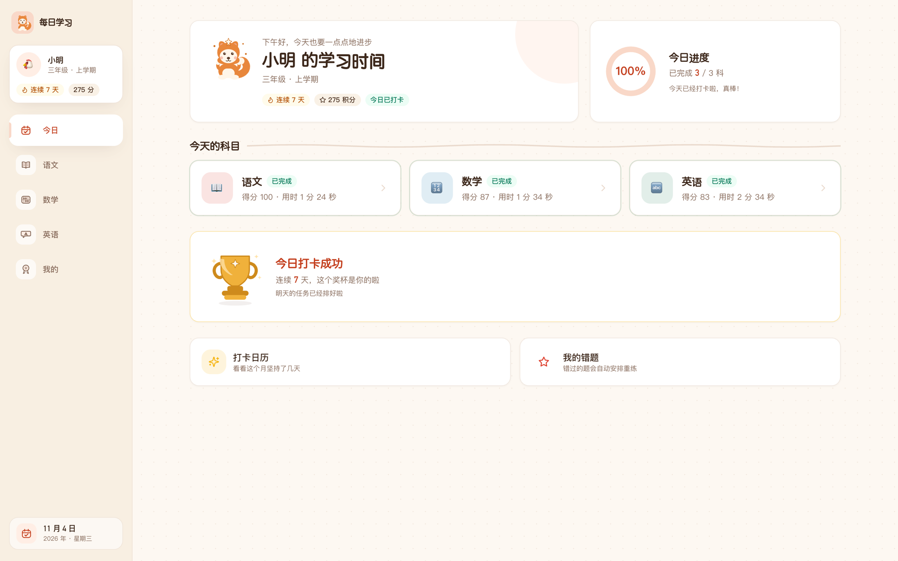
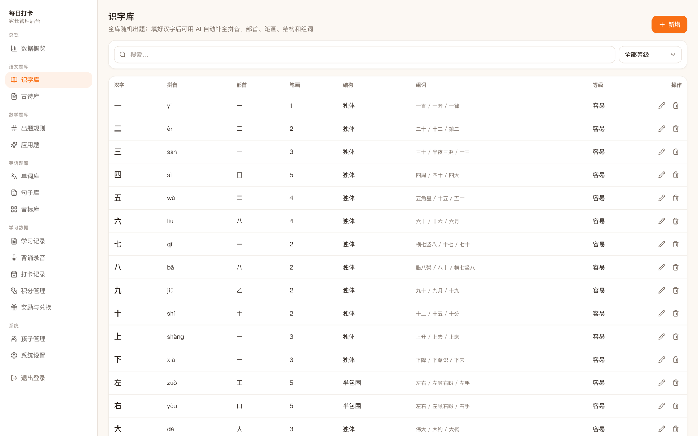
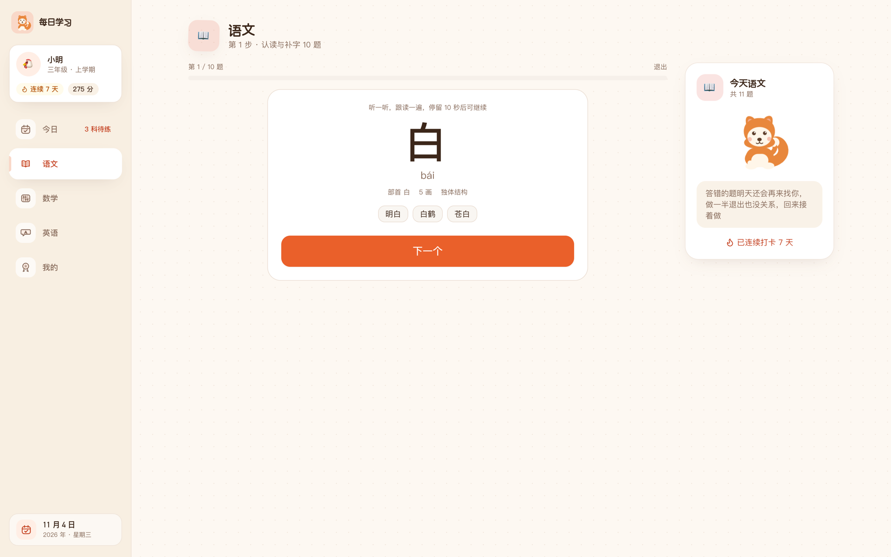
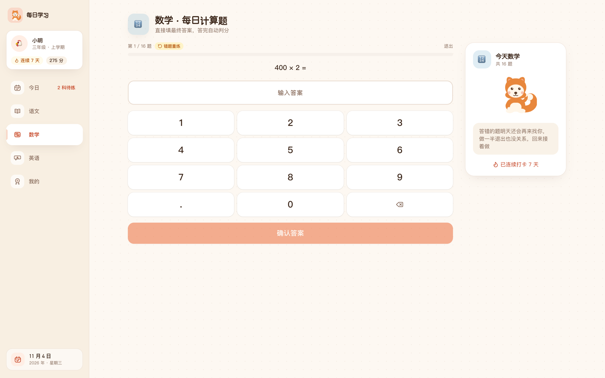
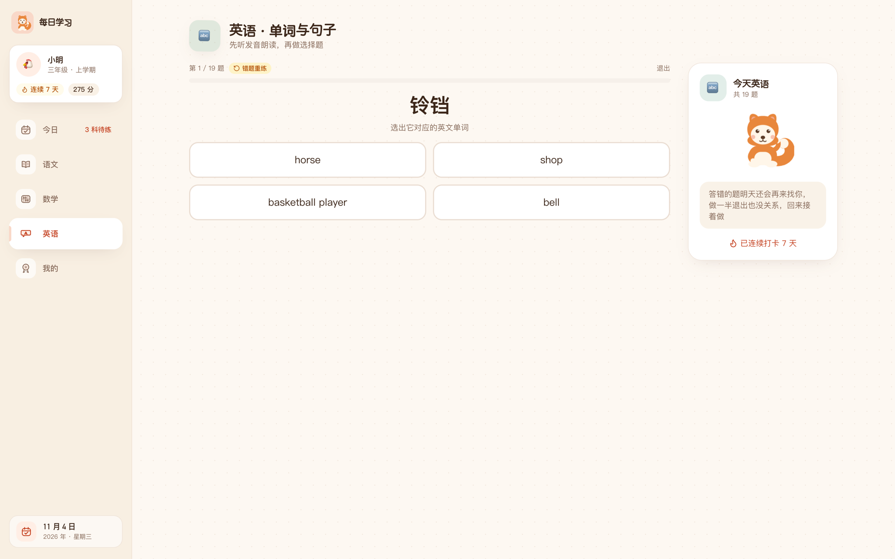
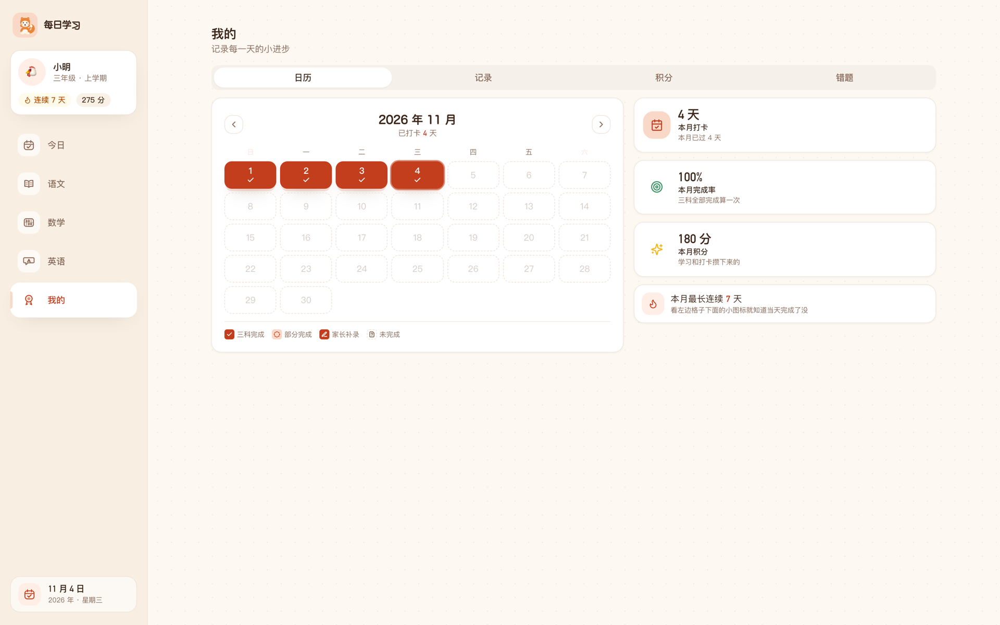
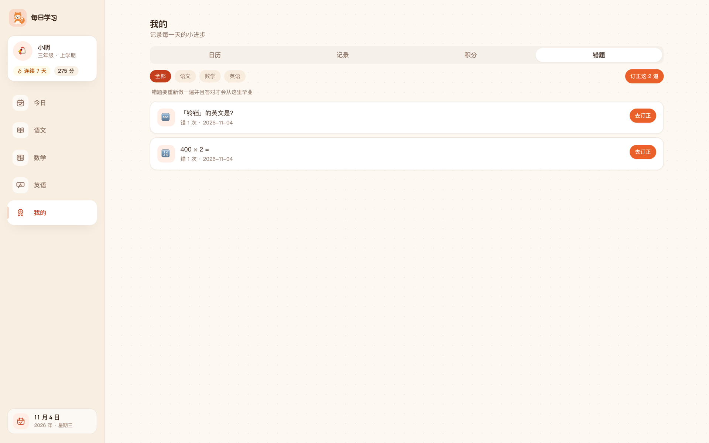
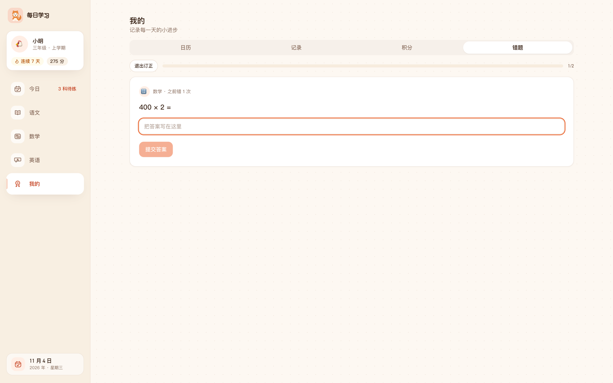
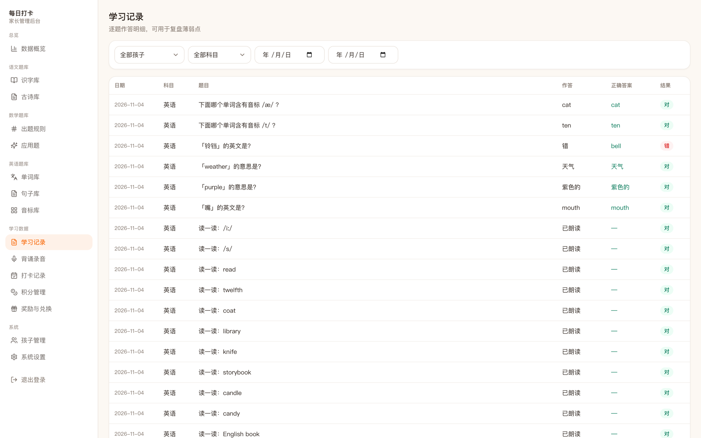

# 每日打卡 · 学习小助手

> 给孩子用的每日学习打卡系统：孩子打开就能学，家长在后台管题库、看数据。

[](LICENSE)
[](api/requirements.txt)
[](web/package.json)
[](api/requirements.txt)
[](docker-compose.yml)



每天三科各一份任务：语文认字读诗、数学计算、英语单词和音标。做完自动判分、记学习记录、发积分；三科都完成才算打卡，连续打卡有额外奖励。中途退出也没关系，回来从下一题接着做。

单家庭自用，不做多租户、不做注册登录：孩子端打开即用，家长端一个密码进后台。数据全部落在一个 `db.sqlite` 文件里，拷走就是完整备份。

## 目录

- [功能](#功能)
- [界面预览](#界面预览)
- [技术栈](#技术栈)
- [快速开始](#快速开始)
- [Docker 部署](#docker-部署)
- [配置项](#配置项)
- [内置题库](#内置题库)
- [接入大模型（可选）](#接入大模型可选)
- [数据与备份](#数据与备份)
- [目录结构](#目录结构)
- [开发约定](#开发约定)
- [已知边界](#已知边界)

## 功能

### 孩子端（`/`，无需登录）

| 模块 | 说明 |
|---|---|
| 今日 | 三科进度、今日得分、打卡状态、连续天数、积分；三科进度分流到各科 |
| 语文 | **认读卡**（字卡带发音、拼音、部首笔画、组词）+ **组词题**（补一个字组成词）+ **古诗**（听读 → 跟读 → 背诵录音，家长后台可回听） |
| 数学 | 口算 + 应用题，数字键盘直接填答案，一题一判；答错自动进错题本 |
| 英语 | 单词朗读、音标朗读（48 个音标配真人录音）、音标选词、看中选英、看英选中、单词组句 |
| 我的 | 打卡日历、学习记录与正确率、积分明细、错题本与专项订正 |
| 通用 | 断点续做、错题重练、遗忘曲线复习、PWA 可加到桌面、客户端限时可用 |

### 家长后台（`/admin`，JWT 登录）

| 模块 | 说明 |
|---|---|
| 数据概览 | 今日完成情况、本周打卡、近 30 天正确率、题库规模、错题分布 |
| 题库 | 识字库 / 古诗库 / 单词库 / 句子库 / 音标库 / 出题规则 / 应用题，统一表格增删改查 + 筛选 + 搜索 |
| 学习数据 | 学习记录（逐题对错）、背诵录音回听、打卡记录（补卡 / 作废）、积分流水、奖励与兑换审批 |
| 系统 | 孩子管理、内置题库一键导入、大模型配置与调用日志、语音配置、客户端可用时段、数据库下载 |



## 界面预览

### 孩子端

| 语文 · 认读卡（发音 + 拼音 + 部首笔画 + 组词） | 数学 · 口算（数字键盘，一题一判） |
|---|---|
|  |  |

| 英语 · 错题重练 | 我的 · 打卡日历 |
|---|---|
|  |  |

| 我的 · 错题本 | 我的 · 专项订正 |
|---|---|
|  |  |

### 家长后台

| 数据概览 | 学习记录（逐题对错） |
|---|---|
|  |  |

## 技术栈

| 层 | 选型 |
|---|---|
| 前端 | React 18 + TypeScript + Vite 5 + Tailwind CSS + shadcn 同源手写组件（Radix）+ TanStack Query + Zustand + Recharts + vite-plugin-pwa |
| 后端 | Flask 3 + SQLAlchemy + Flask-JWT-Extended + SQLite（WAL） |
| 部署 | 单进程 Flask 托管前端产物，或 Docker Compose（dev 热更新 / prod gunicorn 单端口） |
| 可选能力 | DeepSeek（OpenAI 兼容协议）辅助出题；火山引擎豆包 TTS（默认用浏览器自带 TTS） |

## 快速开始

**前置要求**：Python 3.10+、Node.js 18+（推荐 22）。macOS / Linux 直接跑；Windows 建议用 WSL 或 Docker。

```bash
git clone git@github.com:jacksonrick/learn-everyday.git
cd learn-everyday
```

### 1. 后端

```bash
cd api
python3 -m venv .venv
.venv/bin/pip install -r requirements.txt
cp .env.example .env          # 改 SECRET_KEY / ADMIN_PASSWORD
.venv/bin/python run.py       # http://localhost:5001
```

### 2. 前端（开发模式，另开一个终端）

```bash
cd web
npm install
npm run dev                   # http://localhost:5173
```

Vite 的 `/api` 会代理到 `5001`，前后端分开跑，改代码即时生效。

### 3. 生产模式（单端口，局域网可用）

```bash
cd web && npm install && npm run build
cd ../api && .venv/bin/python run.py
```

浏览器打开 `http://<电脑局域网IP>:5001`，同一个 WiFi 下的 iPad / 手机可以直接用，也能「添加到主屏幕」当 App 用。

> 仓库根目录也有等价脚本：`npm run setup` / `npm run dev:api` / `npm run dev:web` / `npm run build` / `npm start`。

首次启动会自动建库并写入：年级（小学 1–6 + 初一至初三，内置只读）、示例孩子、37 条按上下学期分布的数学出题规则、20 个示例字、3 首古诗、10 个单词、48 个国际音标、4 个奖励。

启动后到后台「系统设置 → 内置题库」点一下导入，识字库、古诗库、单词库立刻就满了。

- 孩子端：`http://localhost:5001/`（无需登录）
- 家长后台：`http://localhost:5001/admin`（默认 `admin` / `admin123`，**登录后请立即修改**）

## Docker 部署

镜像里只有运行时（Python 3.12 + Node 22 + 依赖），源码和 `db.sqlite` 都靠挂载，不进镜像。默认跑开发模式，跟本地 `npm run dev` + `python run.py` 完全一致：改代码浏览器里立刻生效，不用重启容器。

```bash
cp api/.env.example .env        # 容器读仓库根目录的 .env
docker compose up -d --build    # 首次构建镜像
docker compose logs -f          # 前后端日志都在这里
```

| APP_MODE | 前端 | 后端 | 端口 |
|---|---|---|---|
| `dev`（默认） | Vite dev server（HMR） | `run.py` + 自动重载 | 5173、5001 |
| `prod` | 构建产物，由 Flask 托管 | gunicorn（1 worker / 8 线程） | 5001 |

```bash
APP_MODE=prod docker compose up -d    # 切生产：启动时 vite build 到命名卷，再起 gunicorn
```

访问 `http://<宿主机IP>:5173/`（后台 `/admin`）。`5001` 是 API 直连，健康检查也打这里。

几个必须知道的点：

- `db.sqlite` 必须和它的 `-wal` / `-shm` 在同一目录，所以挂载整个仓库目录，**不要**单独挂 `db.sqlite` 文件。
- `web/node_modules` 用 Docker 命名卷，别映射宿主机目录：macOS 装的是 darwin 版 esbuild，进 Linux 容器直接崩。
- 改依赖才需要重启：`web/package.json` 变了 → `docker compose restart`；`api/requirements.txt` 变了 → `docker compose up -d --build`。
- 别执行 `docker compose down -v`，会连带删掉 `node_modules` 命名卷（数据在仓库目录里，不会丢，但下次要重装依赖）。
- 首次启动要联网装依赖，pip / npm / apt 默认走国内镜像，可用 `PIP_INDEX_URL` / `NPM_REGISTRY` / `APT_MIRROR` 改回官方或换源。
- dev 模式带 Werkzeug 调试器，别把 5001 / 5173 暴露到不可信网络。

不用 compose 的纯 `docker run` 写法、以及各种参数对应关系见 [docs/02-技术设计.md](docs/02-技术设计.md)。

## 配置项

`api/.env`（Docker 部署时放在仓库根目录 `.env`）：

| 变量 | 默认值 | 说明 |
|---|---|---|
| `SECRET_KEY` | 开发用固定串 | JWT 与 Flask 签名密钥，**上线必须改** |
| `ADMIN_USERNAME` | `admin` | 后台账号（首次启动写入库） |
| `ADMIN_PASSWORD` | `admin123` | 后台密码（首次启动写入库） |
| `PORT` | `5001` | 后端端口 |
| `DATA_DIR` | 仓库根目录 | 数据库与备份目录，可指到别处做多份数据 |

其余运行时配置（每日题量、积分规则、连续奖励、客户端可用时段、语音、大模型）都在后台「系统设置」里改，存数据库，不用重启。

## 内置题库

项目自带三份数据包，不联网、不用一条条录：

| 数据包 | 内容 |
|---|---|
| 识字库 | 2176 个小学常用汉字，含拼音、部首、笔画、结构、组词 |
| 古诗库 | 统编（部编）版小学语文课内古诗词 112 首 |
| 单词库 | 人教 PEP / 新起点小学英语 1–6 年级词汇 740 个，含音标、词性、释义、例句 |

后台 → 系统设置 → 内置题库，点「导入」即可。已存在的条目按汉字 / 古诗标题 / 单词（忽略大小写）自动跳过，不会覆盖你改过的内容，重复点也没有副作用。

导入后的默认行为：语文、英语题库**不关联年级学期**，从全库随机抽；只有数学按孩子的年级 + 学期出题。

数据来源：汉字来自生字表 + Unicode Unihan（拼音/笔画/部首）+ CJKVI IDS（结构）；古诗为人民教育出版社统编版课内篇目；单词按年级拆在人教版教材词表里。重新生成用 `api/scripts/build_chars.py`、`api/scripts/build_poems.py`、`scripts/build_words.py`，产出 JSON 在 `api/app/seed/data/`。

## 接入大模型（可选）

题库录入是主要工作量，所以后台接了大模型来代劳。当前对接 DeepSeek（OpenAI 兼容协议，换 `base_url` 即可接自建代理或其他兼容服务）。

1. 到 [platform.deepseek.com](https://platform.deepseek.com) 创建 API Key
2. 后台 → 系统设置 → AI 智能助手：填 API 地址（默认 `https://api.deepseek.com/v1`）、Key、模型
3. 点「保存并测试连接」，看到「连接成功」即可用

| 场景 | 用法 |
|---|---|
| 汉字 | 识字库「新增」填一个字 → 「AI 补全」，自动生成拼音、部首、笔画、结构、组词、例句 |
| 古诗 | 古诗库「AI 生成」，填数量和补充要求，一次生成多首（按全库标题去重） |
| 单词 / 句子 | 单词库、句子库「AI 生成」，可填主题要求 |
| 出题规则 | 出题规则页「AI 生成」，模型只能从内置出题器里选，不会写代码 |
| 应用题 | 应用题页「AI 生成」，答案强制为纯数字，可直接参与判分 |

生成内容一律经过后端校验（字段白名单、出题器白名单、答案去单位），不合格的丢弃；入库时仍按唯一性去重。API Key 只存在本机 `db.sqlite`，接口只返回掩码。每次调用（含失败）都会写调用日志，可在后台查看。

## 数据与备份

- 所有数据都在根目录 `db.sqlite`（SQLite WAL 模式），**复制即迁移**。
- 每天首次启动自动备份到 `backups/db-YYYY-MM-DD.sqlite`，保留 7 份。
- 后台「系统设置 → 下载数据库」可随时手动备份。

## 目录结构

```
api/                Flask 后端
  app/models/       题库、学习、奖励、系统四类模型
  app/api/          client（无鉴权）/ admin（JWT）/ auth
  app/services/     出题 taskgen、判分 grading、提交 submit、积分 points、复习 srs、AI、TTS
  app/seed/         首次启动数据 + 内置题库 JSON + 手写迁移
  scripts/          内置题库构建脚本
web/                React 前端
  src/pages/client/ 今日、语文、数学、英语、我的
  src/pages/admin/  看板、题库、记录、打卡、积分、奖励、设置
  src/components/   客户端布局、答题内核、古诗播放器、结果页
  public/phonemes/  48 个音标真人单音 mp3
docs/               需求说明、技术设计、开发计划、截图
```

## 开发约定

- **判分只在服务端**：客户端只拿去掉 `answer` 的题目；`/task/answer` 做单题反馈，`/task/submit` 才写记录、算分、发积分。
- **题目身份用题库主键**：复习队列和错题本存的是题库主键（数学是知识点哈希），不是当天第几题。
- **任务幂等**：同一天同一科目重复开始返回同一份题目，并发也不会重复建任务。
- **没有迁移工具**：新表靠启动时 `create_all()`，新列在 `seed/seed.py` 里手写 `ALTER TABLE`。
- **物理删除**：模型没有启用/停用状态，删除即从库里移除。
- 更多踩坑记录与改动约束见 [AGENTS.md](AGENTS.md)；完整设计见 [docs/02-技术设计.md](docs/02-技术设计.md)。

## 已知边界

- 单家庭自用，不做多租户；客户端不设登录，请只在可信网络内使用。
- 录音文件存在服务器 `uploads/` 下供家长回听，客户端不保留。
- 年级是内置只读数据（小学 1–6、初一至初三），只影响数学出题范围。
- 古诗与朗读/认读卡不判分、不计入正确率，只记「学过了」。
- 语音默认用浏览器自带 TTS，可在后台切换为云端 TTS（需自备密钥）。

## License

[MIT](LICENSE)
